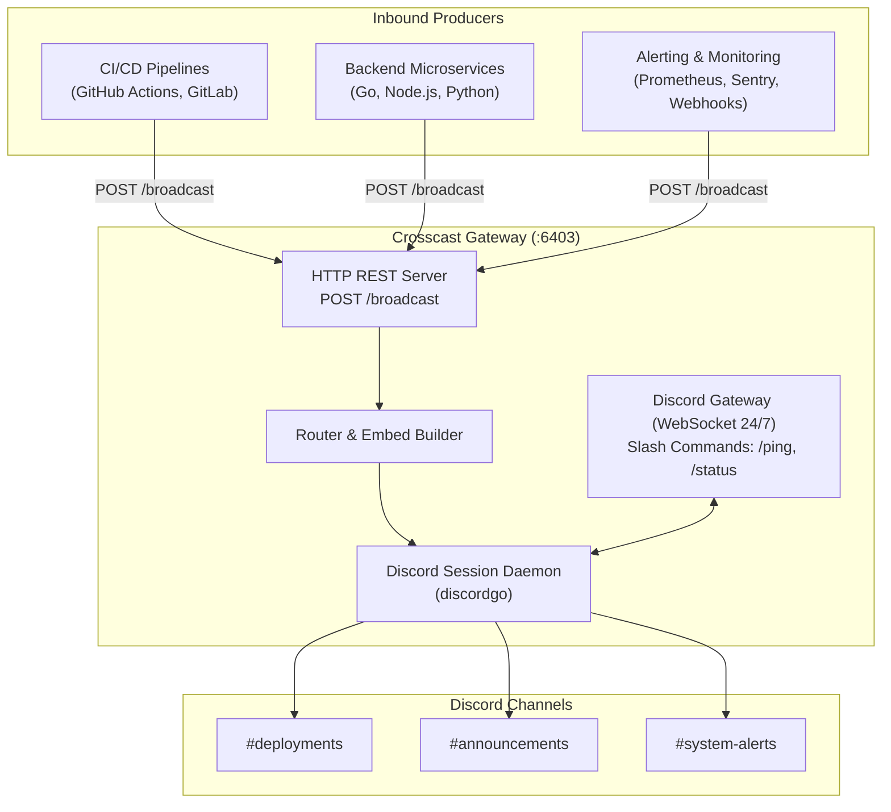

# Crosscast 📡

[](https://golang.org)
[](LICENSE)
[](Dockerfile)
[]()

> **Crosscast** is an ultra-lightweight, multi-tenant social publishing & community broadcasting gateway written in Go.

It bridges the gap between external services (backend microservices, edge workers, CI/CD pipelines, webhooks) and community chat platforms (Discord, and future Telegram/Threads), providing both an **inbound HTTP REST API** and a **persistent 24/7 interactive Discord Bot**.

---

## ⚡ Highlights

- **Ultra-Lightweight**: Uses **< 15 MB RAM** at idle. Zero external database required. Single static binary.
- **24/7 Discord Presence**: Maintains active WebSocket connection to Discord Gateway, remaining visible in member lists with customized activity status.
- **Inbound Broadcast API**: Simple `POST /broadcast` endpoint accepting standard JSON payloads to trigger immediate Discord messages and rich embeds.
- **Dynamic Multi-Tenant Routing**: Map any custom target alias (`alerts`, `announcements`, `deployments`, etc.) via environment variables or pass raw Discord snowflake channel IDs directly.
- **Rich Embed Generator**: Automatically crafts color-coded Discord Embed cards with authors, thumbnails, field grids, and timestamps.
- **Interactive Slash Commands**: Built-in `/ping` and `/status` commands for real-time telemetry and health monitoring.
- **Pure Go & Zero CGO**: Compiles in 1 second, deploys seamlessly to minimal Docker images or Linux VPS.

---

## 🏗️ Architecture



---

## 🚀 Quickstart

### 1. Prerequisites
- [Go 1.22+](https://golang.org/dl/) installed.
- A Discord Bot Token from the [Discord Developer Portal](https://discord.com/developers/applications).

### 2. Configuration
Copy `.env.example` to `.env` and fill in your bot token and channel IDs:

```bash
cp .env.example .env
```

```env
PORT=6403
CROSSCAST_API_KEY=your_secret_api_key

DISCORD_BOT_TOKEN=your_bot_token_here
DISCORD_APP_ID=your_application_id_here

# Channel Routing Map (Target Name -> Channel ID)
CROSSCAST_CHANNELS={"alerts":"123456789012345678","announcements":"123456789012345678","deployments":"123456789012345678"}
```

### 3. Run Locally
```bash
make run
```

---

## 📡 HTTP API Reference

### `POST /broadcast` (or `POST /api/v1/broadcast`)
Broadcasts a message or rich embed to a configured channel.

**Headers**:
- `Content-Type: application/json`
- `Authorization: Bearer <CROSSCAST_API_KEY>` (if configured)

#### Example 1: CI/CD Deployment Notification
```bash
curl -X POST http://localhost:6403/broadcast \
  -H "Authorization: Bearer your_secret_api_key" \
  -H "Content-Type: application/json" \
  -d '{
    "target": "deployments",
    "title": "🚀 Production Release v2.4.0 Deployed",
    "description": "Successfully rolled out new AI engine optimizations.",
    "url": "https://github.com/my-org/my-project/releases/v2.4.0",
    "fields": [
      {"name": "Environment", "value": "Production (us-east-1)", "inline": true},
      {"name": "Triggered By", "value": "GitHub Actions", "inline": true},
      {"name": "Commit", "value": "`a8f23c1`", "inline": true}
    ],
    "footer": {"text": "DevOps Notification System"}
  }'
```

#### Example 2: Payment Webhook Notification
```bash
curl -X POST http://localhost:6403/broadcast \
  -H "Authorization: Bearer your_secret_api_key" \
  -H "Content-Type: application/json" \
  -d '{
    "target": "announcements",
    "title": "🎉 New Sponsorship Received!",
    "description": "Thank you **Alex** for backing the open-source maintenance fund!",
    "fields": [
      {"name": "Tier", "value": "Gold Supporter ($50/mo)", "inline": true},
      {"name": "Platform", "value": "GitHub Sponsors", "inline": true}
    ],
    "footer": {"text": "Community Support Gateway"}
  }'
```

#### Example 3: System Alert
```bash
curl -X POST http://localhost:6403/broadcast \
  -H "Authorization: Bearer your_secret_api_key" \
  -H "Content-Type: application/json" \
  -d '{
    "target": "alerts",
    "content": "🚨 **High Memory Warning**: Database server memory utilization exceeded 90% threshold.",
    "color": 15673636
  }'
```

#### Example 4: Direct Snowflake Channel ID
You can also bypass target names and send directly to any Discord channel ID:
```bash
curl -X POST http://localhost:6403/broadcast \
  -H "Authorization: Bearer your_secret_api_key" \
  -H "Content-Type: application/json" \
  -d '{
    "target": "123456789012345678",
    "content": "Hello from Crosscast direct routing!"
  }'
```

---

### `GET /health`
Returns the status of the HTTP server, Discord WebSocket latency, and memory consumption:
```bash
curl http://localhost:6403/health
```
```json
{
  "service": "crosscast",
  "version": "1.0.0",
  "status": "healthy",
  "bot": {
    "online": true,
    "username": "CrosscastBot#1234",
    "guilds_count": 3,
    "heartbeat_ms": 42,
    "uptime": "4h12m10s",
    "memory_alloc_mb": 11.45,
    "num_goroutine": 18
  }
}
```

---

## 🤖 Discord Slash Commands

When invited to your Discord servers with `applications.commands` and `bot` permissions:
- `/ping`: Responds with the live Discord WebSocket gateway latency.
- `/status`: Displays an embed with uptime, memory consumption, connected guilds, and daemon health.

---

## 🐳 Docker Deployment

Build and run using Docker:

```bash
# Build minimal image
make docker-build

# Run container
docker run -d \
  --name crosscast \
  -p 6403:6403 \
  --env-file .env \
  --restart unless-stopped \
  crosscast:latest
```

---

## 📄 License

MIT License. Maintained by **betothewizard**.
