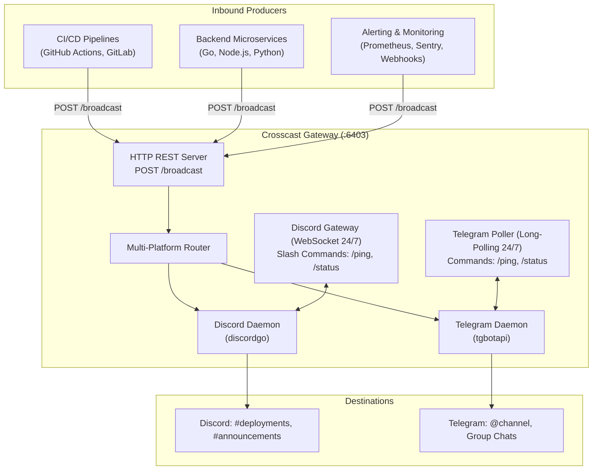

# Crosscast

[](https://golang.org)
[](LICENSE)
[](Dockerfile)
[](https://github.com/betothewizard/crosscast)
[]()

> **Crosscast** is an ultra-lightweight, multi-tenant social publishing and community broadcasting gateway written in Go.

It bridges the gap between external services (backend microservices, edge workers, CI/CD pipelines, webhooks) and community chat platforms (**Discord** and **Telegram**), providing both an **inbound HTTP REST API** and **persistent 24/7 interactive bots**.

---

## Highlights

- **Multi-Platform Broadcasting**: Send a single `POST /broadcast` request and deliver formatted messages simultaneously to **Discord** and **Telegram**.
- **Ultra-Lightweight**: Uses **< 15 MB RAM** at idle. Zero database requirement. Single static binary (~7 MB).
- **24/7 Discord & Telegram Presence**: Keeps persistent WebSocket and update polling connections active with slash commands (`/ping`, `/status`).
- **Inbound Broadcast API**: Simple `POST /broadcast` accepting standard JSON payloads with optional platform filtering (`"platform": "all" | "discord" | "telegram"`).
- **Rich Message Engines**:
  - **Discord**: Automatically crafts color-coded Rich Embed cards with authors, thumbnails, field grids, and timestamps.
  - **Telegram**: Formats clean HTML cards with bold headers, bulleted attribute fields, inline link buttons, and photos.
- **Strict JSON Channel Routing**: Configure target mappings via a single `CROSSCAST_CHANNELS` JSON string in `.env` or pass direct channel/chat IDs.
- **Pure Go & Zero CGO**: Compiles in 1 second, deploys seamlessly to minimal Docker images or Linux VPS.

---

## Architecture



---

## Quickstart

### 1. Prerequisites
- [Go 1.22+](https://golang.org/dl/) installed.
- (Optional) Discord Bot Token from [Discord Developer Portal](https://discord.com/developers/applications).
- (Optional) Telegram Bot Token from [@BotFather](https://t.me/BotFather).

### 2. Configuration
Copy `.env.example` to `.env`:

```bash
cp .env.example .env
```

```env
PORT=6403
CROSSCAST_API_KEY=your_secret_api_key

# Discord Bot
DISCORD_BOT_TOKEN=your_discord_bot_token_here
DISCORD_APP_ID=your_discord_app_id_here

# Telegram Bot
TELEGRAM_BOT_TOKEN=your_telegram_bot_token_here
TELEGRAM_CHAT_ID=-1001234567890

# Target Routing Map (Supports multi-platform broadcast or single-platform)
CROSSCAST_CHANNELS={"alerts":{"discord":"123456789012345678","telegram":"-1001234567890"},"deployments":"123456789012345678"}
```

### 3. Run Locally
```bash
make run
```

---

## HTTP API Reference

### `POST /broadcast` (or `POST /api/v1/broadcast`)
Broadcasts a message or rich card to a configured channel target or direct channel ID.

**Headers**:
- `Content-Type: application/json`
- `Authorization: Bearer <CROSSCAST_API_KEY>` (if configured)

#### Example 1: Multi-Platform Broadcast (Discord + Telegram simultaneously)
```bash
curl -X POST http://localhost:6403/broadcast \
  -H "Authorization: Bearer your_secret_api_key" \
  -H "Content-Type: application/json" \
  -d '{
    "target": "alerts",
    "title": "Database Connection Latency High",
    "description": "Replica lag exceeded 1500ms on primary cluster.",
    "url": "https://monitoring.example.com",
    "fields": [
      {"name": "Cluster", "value": "us-east-prod", "inline": true},
      {"name": "Current Lag", "value": "2.4s", "inline": true}
    ],
    "footer": {"text": "DevOps Telemetry"}
  }'
```

#### Example 2: Platform Filter (Telegram Only)
```bash
curl -X POST http://localhost:6403/broadcast \
  -H "Authorization: Bearer your_secret_api_key" \
  -H "Content-Type: application/json" \
  -d '{
    "platform": "telegram",
    "target": "alerts",
    "title": "Weekly Digest Published",
    "description": "Check out the top engineering highlights of this week!",
    "url": "https://example.com/digest/42"
  }'
```

#### Example 3: Direct Routing
You can bypass aliases and send directly to any ID:
- **Discord**: 18-digit numeric channel ID e.g. `"123456789012345678"`
- **Telegram**: Negative chat ID e.g. `"-1001234567890"` or public channel username e.g. `"@mychannel"`

```bash
curl -X POST http://localhost:6403/broadcast \
  -H "Authorization: Bearer your_secret_api_key" \
  -H "Content-Type: application/json" \
  -d '{
    "target": "@my_public_channel",
    "content": "Hello Telegram from Crosscast direct routing!"
  }'
```

---

### `GET /health`
Returns the status of both Discord and Telegram connections and daemon memory metrics:

```bash
curl http://localhost:6403/health
```
```json
{
  "service": "crosscast",
  "version": "1.0.0",
  "status": "healthy",
  "discord": {
    "online": true,
    "username": "CrosscastBot#1234",
    "guilds_count": 3,
    "heartbeat_ms": 38,
    "uptime": "2h15m",
    "memory_alloc_mb": 9.8
  },
  "telegram": {
    "enabled": true,
    "online": true,
    "username": "CrosscastGatewayBot",
    "uptime": "2h15m"
  }
}
```

---

## Bot Commands

Both bots support built-in operational commands:
- `/ping`: Responds with live gateway responsiveness.
- `/status`: Displays daemon uptime, memory, and operational status.
- `/start` (Telegram): Welcomes the user and explains available commands.

---

## Docker Deployment

```bash
# Build minimal image
make docker-build

# Run container
docker run -d \
  --name crosscast \
  -p 6403:6403 \
  --env-file .env \
  --restart unless-stopped \
  crosscast:latest
```

---

## License

MIT License. Maintained by **betothewizard**.
